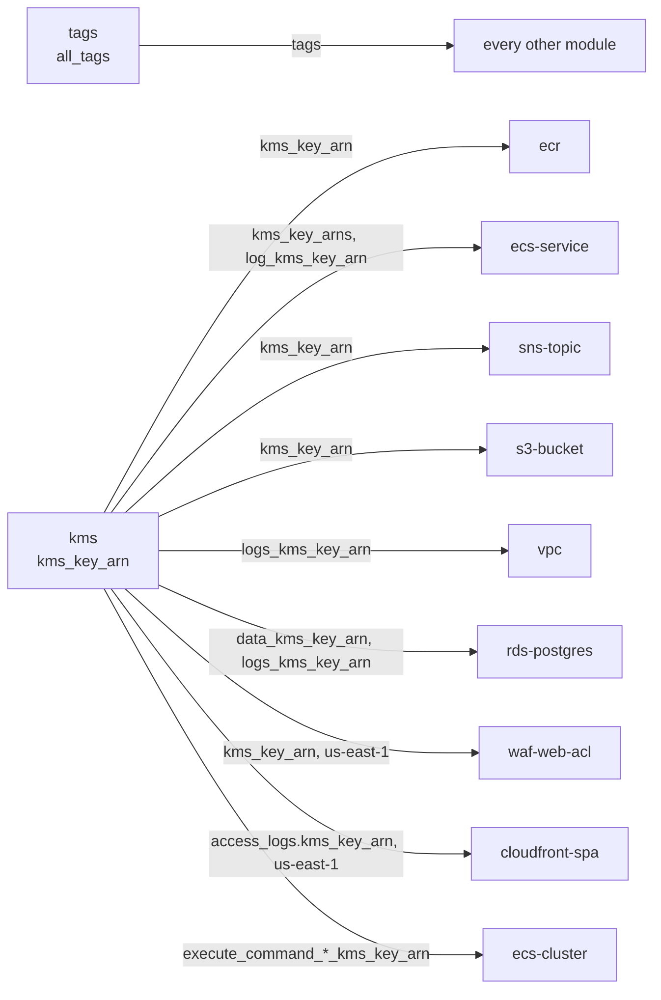
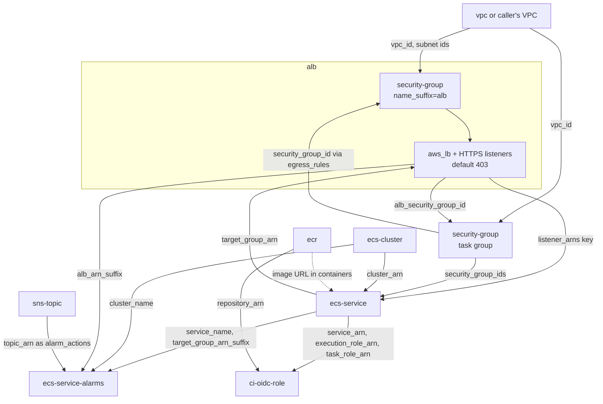
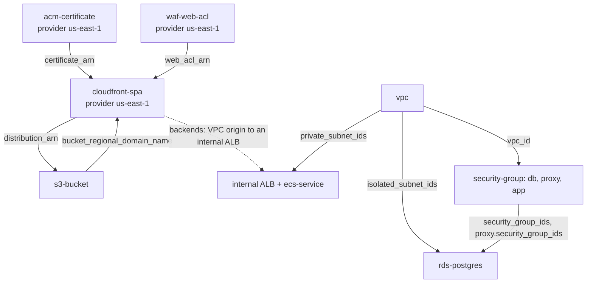
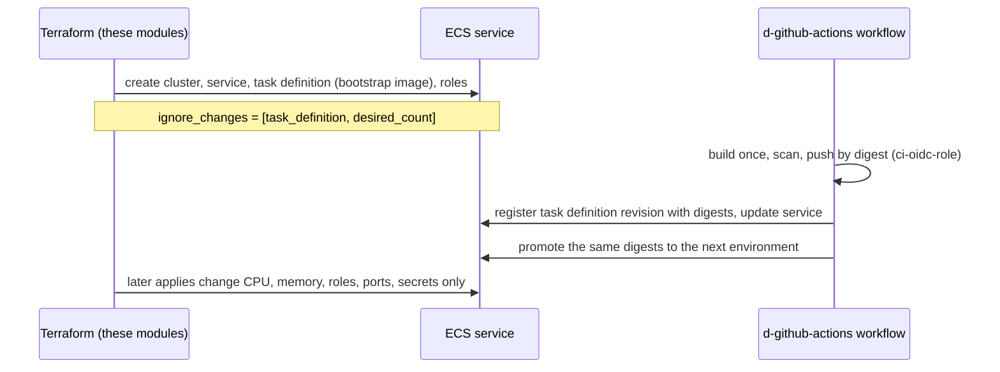

# Architecture

> Generated 2026-10-31 (INIT). Diagrams are drawn from `README.md` ("How the pieces fit"), `examples/ordering-agent/main.tf` and the `examples/basic/main.tf` of `cloudfront-spa` and `rds-postgres`.

## Style

A flat library of leaf modules composed by the caller. Each module owns one AWS concern, takes everything it depends on as an input (IDs, ARNs, keys) and exposes what others need as outputs. Modules do not look up resources they do not own: the VPC, subnets, keys, hosted zone, certificate and OIDC provider all arrive as inputs (each README's "Does not own" section). Only `alb` → `security-group` and `ecr` → `kms` are nested calls (`modules/alb/main.tf:38`, `modules/ecr/main.tf:35`).

Confidence: Verified.

## Cross-cutting inputs

`tags` is the only module with no provider. Its `all_tags` output is passed as `tags` everywhere (`modules/tags/outputs.tf:1-14`); every resource-creating module then adds `Name` with `merge(var.tags, { Name = ... })`.

`kms` is called once per purpose with a `name_suffix` (for example `app`, `sessions`, `alarms` in `examples/ordering-agent/main.tf:30-74`). The key policy has to admit the service that will use it. The examples do this through `service_grants`: `logs.<region>.amazonaws.com` scoped by `kms:EncryptionContext:aws:logs:arn`, `cloudwatch.amazonaws.com` for an alarm topic, `cloudfront.amazonaws.com` scoped by `aws:SourceArn` for a static-site bucket.

## ECS service composition

The load balancer group and the task group reference each other: the task group admits the ALB group on the container port, the ALB group lists the task group as egress (`README.md` "How the pieces fit"; `examples/ordering-agent/main.tf:150-185`). There is no dependency cycle because rules are separate `aws_vpc_security_group_*_rule` resources, which the example's test proves (`examples/ordering-agent/README.md`).

`alb` with `cloudfront_only = true` plus a `header_forward_rules` entry carrying a random secret header is the pattern for "only my CloudFront distribution may reach this origin" (`modules/alb/variables.tf:71-75`, `examples/ordering-agent/main.tf:130-148`). `ecs-service` adds its own listener rule by host header or path pattern; the ALB's default action stays 403.

## Three-tier web composition

The bucket ↔ distribution mutual reference works because the bucket policy is its own resource (`modules/s3-bucket/main.tf:114-122`) and the distribution only needs the bucket's domain name (`modules/cloudfront-spa/examples/basic/main.tf`). `cloudfront-spa` does not create the VPC origin itself; it takes `vpc_origin_id` per backend (`modules/cloudfront-spa/variables.tf:84-101`).

The `vpc` module's subnet tiers map to roles: public (NAT gateways, external load balancers), private (tasks and interface endpoints, routed out through the NAT of their zone), isolated (databases, no route out) (`modules/vpc/outputs.tf:16-29`). Layout is fixed for a `/16`: for zone `i`, public is `cidrsubnet(cidr, 8, i)` (a `/24`), isolated is `cidrsubnet(cidr, 8, 10 + i)` (a `/24`) and private is `cidrsubnet(cidr, 6, 4 + i)` (a `/22`) (`modules/vpc/main.tf:7-9`).

## Runtime ownership split with d-github-actions

Source: `README.md` steps 1-3 and `modules/ecs-service/main.tf:91-141`. Autoscaling, when set, owns desired count after creation (`modules/ecs-service/main.tf:191-238`).

## What lives outside the library

Hosted zones, OIDC provider (unless `create_oidc_provider = true` in exactly one role), VPC origins, application secrets referenced by `ecs-service` containers, database roles inside PostgreSQL (`rds-postgres` only creates their Secrets Manager secrets, `modules/rds-postgres/variables.tf:143-149`), ALB access-log buckets and policies, and Lambda.
